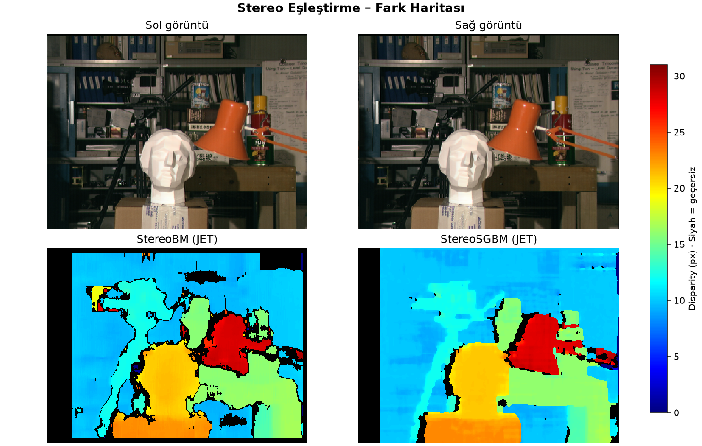

# Hafta 10 · Stereo eşleştirme

## 1. OpenCV StereoBM ve StereoSGBM

[Kod](../stereo_eslestirme.py) · [Tsukuba karşılaştırması](cikti/stereo_comparison.png)

Rektifiye edilmiş görüntülerde eşleşme aynı satırda aranır. Sol pikselin yatay konumu `xₗ`, sağdaki eşinin konumu `xᵣ` ise fark (disparity) `d = xₗ − xᵣ` piksel olur. OpenCV çıktısının sabit noktalı değeri 16'ya bölünür ve piksel cinsinden `.npy` olarak kaydedilir. [OpenCV stereo belgeleri](https://docs.opencv.org/4.x/d9/d0c/group__calib3d.html#gad8069d31d2ed0de4cfc60815a5b2438b)

Varsayılan arama aralığı iki haritada da 0–31 pikseldir. **Mavi** küçük kaymayı ve genellikle uzak bölgeleri, **yeşil ve sarı** orta değerleri, **kırmızı** büyük kaymayı ve genellikle yakın bölgeleri gösterir. **Siyah**, eşleşme değeri üretilmemiş pikselleri gösterir. Sayısal haritada bu pikseller `-1` ile tutulur. Örnekte lamba sıcak renklerde, arka raflar soğuk renklerdedir. StereoBM piksellerin %72,06'sına, StereoSGBM %87,89'una değer atadı. Bu oran, eşleşmenin ne kadar alana yayıldığını gösterir. Doğruluk için her tahmini hizalı referansla karşılaştırmak gerekir.

Harita piksel cinsinden kaymaya dayalı göreli derinlik verir. Fiziksel uzaklık için kalibrasyon gerekir. Yatay rektifikasyon ve aynı yatay asal nokta varsayımıyla `Z = fₓ B / d` kullanılır. Burada `fₓ` piksel cinsinden odak uzunluğu, `B` kameralar arası mesafedir. Örneğin `B` metre verilirse `Z` de metre çıkar. `d = 0` veya geçersiz eşleşmeler için bu formülden sonlu bir mesafe alınamaz. [OpenCV stereo kalibrasyon belgeleri](https://docs.opencv.org/4.x/d9/d0c/group__calib3d.html)



## 2. Kendi blok eşleştirme fonksiyonumuz

[Kod](../stereo_eslestirme_odev.py) · [OpenCV StereoBM ile karşılaştırma](cikti/stereo_odev_cikti.png)

`soru2_kendi_blok_eslestirme`, her aday `d` için sol görüntüdeki blokla sağdaki `x − d` merkezli bloğu karşılaştırır. İntegral görüntü, bir bloktaki farkları dört tablo erişimiyle toplar. Her piksel için maliyeti en küçük yapan kayma seçilir. Tam pencere iki görüntüye de sığmalıdır. Fonksiyon NumPy ile çalışır ve OpenCV StereoBM yalnızca karşılaştırma çıktısında çağrılır.

## 3. SAD, SSD ve ZNCC

[Kod](../soru3_sad_ssd_zncc.py) · [Tsukuba karşılaştırması](cikti/soru3_sad_ssd_zncc_cikti.png)

| Yöntem | Blok maliyeti | Avantaj | Dezavantaj |
|---|---|---|---|
| SAD | `Σ abs(L − R)` | Basit, büyük tekil hatalara SSD'den daha az ağırlık verir. | İki kamera arasındaki parlaklık ve kontrast değişimlerine duyarlıdır. |
| SSD | `Σ (L − R)²` | Büyük uyumsuzlukları daha güçlü cezalandırır. | Aykırı piksel değerleri ve aydınlatma değişiklikleri maliyeti büyütebilir. |
| ZNCC | `1 − corr(L, R)`, ortalamalar çıkarıldıktan sonra | Kırpma olmadığında pozitif doğrusal kontrast ve parlaklık değişimlerine dayanıklıdır. | Daha fazla hesap gerektirir. Varyansı sıfır olan blokta tanımsızdır. |

Üç Python fonksiyonu aynı `(left, right_shifted, block_size)` imzasını kullanır. `blok_eslestirme` bunları `Callable` olarak alır. C++ uygulamasında bu seçim, üç fonksiyonun aynı türde bir fonksiyon pointer’ına atanmasıyla yapılabilir.

[Sentetik deneyde](../test_stereo.py) gerçek kayma 6 px, blok boyutu 5×5 ve arama aralığı 0–15 px. Aynı 5.152 iç piksel ölçüldü. İkinci koşulda sağ görüntüye yuvarlanmış `1,5 × I + 35` dönüşümü uygulandı. Bu deney, yöntemlerin belirli bir parlaklık ve kontrast değişimine verdiği tepkiyi ölçer.

| Yöntem | Aynı parlaklıkta tam 6 px | Değişim sonrası tam 6 px | Değişim sonrası ortalama mutlak hata |
|---|---:|---:|---:|
| SAD | %100 | %19,18 (988 / 5.152) | 3,93 px |
| SSD | %100 | %72,67 (3.744 / 5.152) | 1,57 px |
| ZNCC | %100 | %100 (5.152 / 5.152) | 0,00 px |

## 4. Sıfırdan SGBC / SGBM

[Kod](../soru4_sgbm_sifirdan.py) · [Smoothness karşılaştırması](cikti/soru4_sgbm_smoothness_cikti.png)

Ödevdeki SGBC için blok SAD kullanan yarı küresel eşleştirme uygulandı. Önce her `(y, x, d)` için ortalama SAD maliyeti hesaplanır. Ardından maliyet, varsayılan olarak sekiz yönde dinamik programlamayla biriktirilir. Son olarak yönlerin toplam maliyetini en aza indiren `d` seçilir. [Hirschmüller'in SGM makalesi](https://elib.dlr.de/55367/)

- `P1`, komşu pikseller arasındaki **1 px** kayma değişimini cezalandırır. Küçük bir `P1` eğimli yüzeylerdeki kademeli değişimlere izin verir.
- `P2`, **1 px'ten büyük** sıçramaları cezalandırır. `P2 ≥ P1` koşulu uygulanır. İkisi sıfır olunca her blok kaymasını bağımsız seçer.
- Daha büyük cezalar komşu tahminleri daha tutarlı yapar, ancak gerçek derinlik sınırlarının silinmesine de yol açabilir.

Tsukuba çiftinde ortak iç bölgede (`[10:-10, 40:-10]`), yatay ve dikey komşular arasında **1 px’i aşan sıçrama oranı** `(0, 0)` için %14,30, `(10, 120)` için %2,27 ve `(50, 480)` için %2,18 oldu. En yüksek cezalı haritada lambanın ince uzantısı kısmen kayboluyor. Bu oran yumuşaklığı ölçer. Piksel doğruluğunun ölçümü için referans disparity gerekir.

## Çalıştırma

Depo kökünde Python 3 ile bağımlılıkları kurun. Tsukuba görüntülerini aşağıdaki adlarla `tsukuba/` klasörüne indirin. Kendi rektifiye edilmiş çiftinizi `--left` ve `--right` ile verebilirsiniz. [Middlebury Tsukuba veri dizini](https://vision.middlebury.edu/stereo/data/scenes2001/data/tsukuba/)

```powershell
python -m pip install numpy opencv-python matplotlib
New-Item -ItemType Directory -Force tsukuba
$base = "https://vision.middlebury.edu/stereo/data/scenes2001/data/tsukuba"
curl.exe -fsSL "$base/scene1.row3.col1.ppm" -o tsukuba/scene1.row3.col1.ppm
curl.exe -fsSL "$base/scene1.row3.col3.ppm" -o tsukuba/scene1.row3.col3.ppm
python stereo_eslestirme.py
python stereo_eslestirme_odev.py
python soru3_sad_ssd_zncc.py
python soru4_sgbm_sifirdan.py
python -m unittest -v test_stereo
```

Varsayılan `outputs/` dizininde gri ve renkli PNG'ler, karşılaştırma panoları ve piksel cinsinden `.npy` dizileri oluşur. Testler, varsa yerel stereo görüntülerden bağımsız olarak 6 px kayma, blok sınırları, ZNCC ve SGM cezalarını sınar. Doğrulama ortamı Python 3.14.4, OpenCV 4.14.0 ve NumPy 2.4.6.
