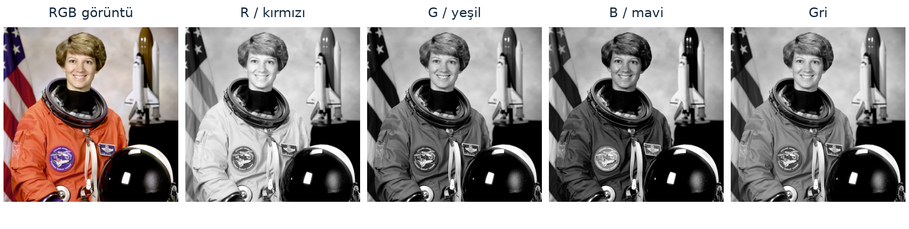
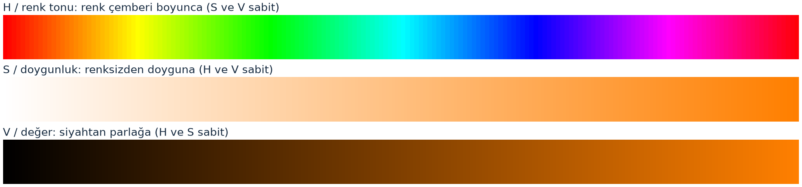
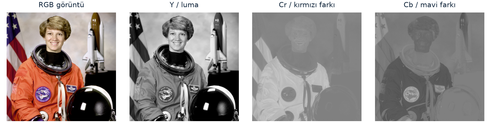
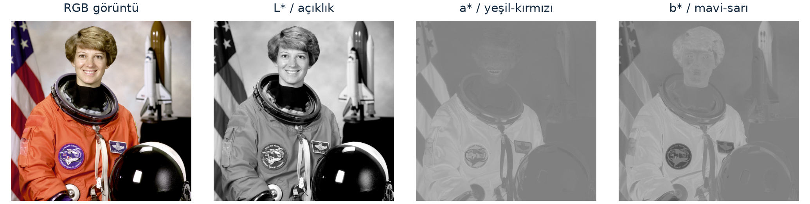

# 9.1 - Renk uzayları: görselli ders notu

**Ödev:** Yaygın renk uzaylarını, avantaj ve dezavantajlarını araştırmak; hangi problemde hangisinin seçileceğini açıklamak.

[Üç sayfalık ders notunu aç (PDF)](cikti/renk_uzaylari_ders_notu.pdf). Notta gerçek görüntünün kanalları, HSV bileşenleri, HSV-HSI farkı ve seçim tablosu bulunur.

Renk uzayı, pikseli farklı bileşenlerle ifade eder. Dönüşüm yeni görüntü bilgisi üretmez; yapılacak işlem için renk, açıklık veya krominansı ayırmayı kolaylaştırır. Her problemde üstün tek bir uzay yoktur.

## RGB ve gri

RGB görüntü edinme ve gösterimde doğrudan kullanılır. Renk ve parlaklık aynı kanallara yansır; yalnız RGB eşikleri ışık değişiminde zorlanır. RGB sayılarını tam yorumlamak için sRGB gibi tanımlı bir kodlama gerekir. OpenCV görüntüyü varsayılan olarak **BGR** sırasıyla okur.

Gri dönüşümünde yaklaşık `0,299R + 0,587G + 0,114B` kullanılır. Tek kanal kenar, doku ve şekil analizini sadeleştirir. Ancak farklı renkler aynı griye dönüşebilir; renk bilgisi geri getirilemez. [1, 2]

## HSV ve HSI

HSV'de H ton, S doygunluk, V en büyük RGB bileşenidir. HSI'de I, `(R+G+B)/3` aritmetik ortalamasıdır. Örneğin kırmızı `(255,0,0)` için V=255, I=85'tir. HSI ile HLS aynı değildir; I algısal açıklık da değildir. [1, 3]

HSV, kontrollü ışıkta renkli nesne takibi ve renk maskesi için kullanışlıdır. Düşük doygunlukta veya karanlıkta ton güvenilmez; bu yüzden S/V alt eşikleri gerekir. Ton çemberinde kırmızı başlangıç ve bitiş uçlarında yer alabilir. HSV ve HSI, gölge ve beyaz dengesi değişimlerine bütünüyle dayanıklı değildir.

## YUV, YCbCr ve Lab

YUV tarihsel olarak analog video, YCbCr sayısal görüntü/video kodlamasıyla ilişkilidir. Y luma; Cb/Cr renk farkı bileşenleridir. Luma, doğrusal fiziksel luminans ile aynı değildir. Krominans ayrımı ten rengi adaylarını seçmeyi kolaylaştırabilir. Sabit eşikler farklı ışık ve tenlerde yine hata yapar. OpenCV'de **YCrCb sırası Y, Cr, Cb** olduğundan kanal sırası karıştırılmamalıdır. [1, 4, 5]

Lab'de L* açıklığı, a* yeşil-kırmızı, b* mavi-sarı yönünü gösterir. Yaklaşık algısal düzgünlük, ortak çekim ve beyaz referansı altında renk farklarını karşılaştırmayı kolaylaştırır. Düzgünlük kusursuz değildir; farklı beyaz noktalarıyla hesaplanan değerler doğrudan karşılaştırılmaz. [6]

## Hangi problemde hangisi?

| Uzay | Avantajı / uygun problem | Dezavantajı |
|---|---|---|
| RGB | Kamera, ekran, doğrudan kanal işlemleri | Renk ve parlaklık iç içe; ışık değişimine hassas |
| HSV | Renkli nesne ayırma ve renk eşiği | Ton çembersel; düşük S/V'de kararsız |
| HSI | Yoğunluğu renk tonu/doygunluktan ayrı işleme | I algısal açıklık değil; gri/siyah sınırları ele alınmalı |
| YUV | Luma ve renk farkını ayrı işleyen video zinciri | İsim tek başına veri düzenini veya örneklemeyi açıklamaz |
| YCbCr | Sayısal video/JPEG, krominans eşiğiyle ten örneği | Standart, değer aralığı ve Cr/Cb sırası önemli |
| CIE Lab | Renk benzerliği, kümeleme, kalite kontrolü | Daha fazla hesap; beyaz referansına bağlı; düzgünlük yaklaşık |
| Gri | Kenar, şekil ve doku; tek kanallı veri | Renk bilgisi kaybolur |

Üç kanallı RGB'yi aynı çözünürlük ve bit derinliğinde üç kanallı YUV/YCbCr'ye çevirmek tek başına disk alanı kazandırmaz. Tasarruf alt örnekleme veya sıkıştırmayla oluşur. BMP başlık ve palet yükünü de içerir; bu nedenle renkli/gri dosya oranı tam 3 olmayabilir. Gerçek ölçüm [9.2 boyut raporundadır](../9.2-bmp-gri/cikti/boyutlar.txt). [4, 5]

## Kaynaklar

1. [OpenCV - Color conversions](https://docs.opencv.org/4.x/de/d25/imgproc_color_conversions.html): dönüşümler, katsayılar ve kanal aralıkları.
2. [ICC - sRGB](https://registry.color.org/rgb-registry/srgb): tanımlı RGB kodlaması.
3. [Pascal Getreuer - Colorspace Transforms](https://gmao.gsfc.nasa.gov/media/gmaoftp/jkolassa/Matlab_scripts/colorspace.html): HSV/HSI bileşenleri ve dönüşüm formülleri.
4. [ITU-R BT.601](https://www.itu.int/rec/R-REC-BT.601): sayısal video kodlaması.
5. [Microsoft - About YUV Video](https://learn.microsoft.com/en-us/windows/win32/medfound/about-yuv-video): luma, krominans ve alt örnekleme.
6. [CIE - CIE 1976 L*a*b* colour space](https://cie.co.at/eilv/157): yaklaşık algısal düzgünlük ve referans beyazı.

Kanal görselleri [ortak BMP'den](../girdi/renkli.bmp) üretildi. NASA fotoğrafının [kaynak açıklaması](../girdi/KAYNAK.md).
